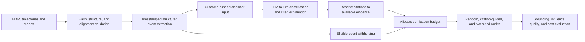

# TraceAudit: Cost-Efficient Verification of LLM Explanations for Robotic Failure Classification

**Status: ongoing research.** This repository combines a validated robotic-trace preparation pipeline with provider-neutral infrastructure for future LLM explanation and evidence-verification experiments. It does not report an evaluated LLM classifier or a demonstrated improvement from verification.

## Overview

LLMs can produce explanations that cite plausible events without those events accurately reflecting the evidence behind a prediction. TraceAudit studies how to check evidence grounding and behavioral sensitivity efficiently by auditing selected cited and uncited events in multimodal robotic execution traces.

Evidence grounding and behavioral sensitivity are separate properties. A citation can resolve to a real event and its underlying recorded evidence without semantically supporting the explanation. Withholding an event can show that a model's output changes when that event is unavailable; this perturbation alone does not prove that the event causally produced the prediction or that the explanation is faithful. The current software enforces structural citation checks and supports single-event withholding, but no real LLM experiment has been run.

The project is a Big Data Systems research project at York University. It is scientifically distinct from the author's ISSTA VLA failure-analysis and Trustworthy AI safety-case-generation projects. Some source execution data and research infrastructure are shared; their code and results are not included here unless specifically identified as TraceAudit components.

## Research objectives

The audited TraceAudit workspaces did not contain an authoritative current proposal or RQ1–RQ3 statement. These working questions summarize the current methodology and should be reconciled with the approved proposal before being treated as frozen research questions:

1. **Working RQ1 — Explanation evidence:** How often do LLM-generated robotic failure explanations cite available events, and how well do those citations ground the claims made?
2. **Working RQ2 — Event influence:** How does selectively withholding cited and uncited events change classification and explanation outputs, and which events are influential under this perturbation test?
3. **Working RQ3 — Audit efficiency:** Under a fixed verification budget, how do random, citation-guided, and two-sided cited/uncited auditing compare in influential-event recall, grounding assessment, and computational cost?

These questions describe planned evaluation. None is answered by the currently available LLM results.

## Dataset

The source catalog contains **4,000 unique OpenVLA-OFT executions** across LIBERO tasks and five checkpoint groups: Combined (2,000), Goal (500), LIBERO-10 (500), Object (500), and Spatial (500). The catalog reports 3,827 successful and 173 unsuccessful episodes. The source report states that all catalog failures have `time_limit` termination; this is an outcome/termination field, not a verified physical failure cause.

The catalog describes HDF5 trajectories with executed actions, frame and transition records, end-effector positions, tracked-entity positions, simulator timestamps, and video observations. Current extraction creates structured records for numeric action-component runs, end-effector motion segments, and tracked-entity position changes. It preserves simulator source times as unverified and normalized event times as null. The current evidence pipeline does not establish contact, grasp, support, collision, or task-predicate truth from these measurements.

The latest validated extraction package has **2,040 processed episodes and 17,731 structured events**: 8,717 gripper-command runs, 4,851 end-effector motion segments, and 4,163 tracked-entity position changes. This is a processed subset, not the whole 4,000-episode corpus. Another 1,960 Combined payloads were unavailable in authorized local storage at the audit date. A separate 50-ID, outcome-balanced reference sample has 25 validated members and 25 unavailable Combined members; no members were replaced. A 10-episode event audit reviewed 145 events. These denominators are distinct and must not be conflated.

The previously circulated figure of 34,180 extracted events was not supported by the latest authoritative validation artifacts and is not reported here. Source manifests, per-episode outputs, outcomes, and reference IDs are not included in this repository.

## Methodology

The intended research pipeline is:



The execution-to-event extraction, schema validation, outcome isolation, classifier-input contract, citation parsing/grounding checks, single-event withholding, and query/token/runtime accounting have implementations. Provider integration, real classification, budget allocation/strategy comparison, reference-label scoring, and end-to-end evaluation remain pending or gated.

## Verification strategies

- **No verification:** a planned reference condition for the un-audited output, where applicable.
- **Random verification:** planned baseline for selecting eligible events within a fixed budget.
- **Citation-guided verification:** planned selection guided by events cited by the explanation.
- **Two-sided verification:** planned selection covering cited and uncited evidence.

The current LLM infrastructure implements single-event withholding and mechanical citation resolution. It does not implement or evaluate these budget-allocation strategies. Budgets such as B=4 and B=6 appear in the local demonstration as not evaluated; no authoritative current methodology confirmed them, so they are not treated as frozen settings here.

## Evaluation

Planned measures include influential-event Recall@B, citation/evidence grounding, cited and omitted influential evidence, classification macro-F1, agreement with human references, invalid or indeterminate perturbations, provider query count, token consumption, runtime, and scalability. The infrastructure records request counts, cache hits, token sources and amounts when supplied by a provider, runtime, status, and hashes. Missing token values remain unknown rather than estimated.

No classification-performance, faithfulness, grounding-improvement, recall, runtime-reduction, or cost-reduction result is currently reported. Referential citation checks establish only that a cited ID resolves to an available event with evidence references; they do not establish semantic support.

## Installation

Python 3.10 or newer is required. The base package uses `jsonschema`; tests use `pytest`.

```bash
python -m venv .venv
source .venv/bin/activate
python -m pip install -e ".[test]"
```

The data extraction environment is not packaged here because it depends on private research storage and site-specific source manifests.

## Usage

Run the synthetic, CPU-only classifier-contract tests:

```bash
pytest -q
```

The provider-neutral functions can also be used from Python with an approved, outcome-blinded trace:

```python
from traceaudit.llm_infra import build_input, ground_response, withhold_single_event

request = build_input(trace, task_instruction)
grounding = ground_response(request, response)
perturbed = withhold_single_event(request, event_id)
```

The API contract, fail-closed experiment gate, and synthetic fixtures are in `src/traceaudit/llm_infra.py` and `tests/`. There is no provider adapter or command-line interface for real classification. Extraction and corpus batch source was reviewed but is not copied here: the pilot extractor embeds a small episode selection with outcomes, and the full runner is bound to private Hestia paths and source manifests. Its validated behavior and provenance are summarized without episode-level data in the audit documentation.

## Repository structure

- `src/traceaudit/`: importable provider-neutral LLM input, citation, withholding, cache, and accounting code with JSON schemas.
- `tests/`: CPU-only tests using explicitly synthetic examples.
- `research/source-snapshots/`: selected versioned schema validators retained with their original provenance.
- `docs/`: audit evidence, research status, limitations, and provenance.
- `data/` and `results/`: sharing guidance only; research datasets and generated outputs are excluded.
- `.github/workflows/`: CPU-only CI.

## Research status

| Stage | Status | Evidence and limits |
|---|---|---|
| 4,000-execution catalog and outcome counts | **Complete for catalog audit** | 4,000 unique rows; 3,827 success, 173 failure; this does not mean all payloads were validated. |
| Structured extraction and validation | **Partial, validated subset** | 2,040 episodes / 17,731 events processed; 1,960 Combined payloads unavailable under authorized local roots. |
| 10-episode event audit | **Complete for audited sample** | 145/145 event windows reviewed; deterministic extraction recomputation matched all 145. Limits are documented in the audit report. |
| Schema v1.1/v1.2 | **Implemented and validated** | Stable IDs, provenance, outcome isolation, and unverified timestamp policy; schema tests passed on Hestia. |
| Human reference | **Pending** | The 50-ID reference sample is incomplete (25 validated, 25 unavailable); no full human-reference labels exist. A separate small C01 codebook pilot reported 10/10 agreement but does not establish general category validity. |
| Classifier-input and explanation contract | **Implemented, synthetic-tested** | Provider-neutral schemas, outcome-leakage checks, citation parsing, and cache/accounting; no provider adapter or real LLM calls. |
| Event withholding | **Implemented as infrastructure** | Single-event withholding is covered by synthetic tests; real perturbation sensitivity is unevaluated. |
| Budget strategies and final evaluation | **Pending** | Random, citation-guided, and two-sided strategies and all comparative metrics await frozen study protocol and reference data. |

TraceAudit remains ongoing research. Detailed stage provenance and limitations are in [`docs/research-status.md`](docs/research-status.md).

## Reproducibility

The validated research artifacts use versioned manifests and schemas, stable event IDs, per-source hashes, deterministic event thresholds, saved progress records, explicit synthetic fixtures, outcome-separated outputs, and validators. The extraction thresholds and frame/transition mapping are documented in the source provenance records; this repository does not change them. Source simulator times remain explicitly unverified. The LLM cache binds requests to provider/model, prompt, codebook, reference-lock, and generation-parameter hashes; real provider calls fail closed unless the experiment gate is satisfied.

The Hestia-only batch scripts depend on local catalogs, source roots, exact task archives, validators, and media tools. The source was audited but not copied because it embeds site-specific paths and, in the pilot extractor, a fixed outcome-stratified episode selection. Aggregate validation counts are recorded here without per-episode records. CPU CI tests only the self-contained synthetic LLM contract; it does not access a GPU, cluster, real dataset, or provider API.

## Citation

```text
Akbarpour, Nikta. TraceAudit: Cost-Efficient Verification of LLM Explanations
for Robotic Failure Classification. Ongoing research software, York University.
```

No publication, DOI, conference acceptance, or publication date is claimed.

## Author

**Nikta Akbarpour**
PhD Researcher, York University

Component-level collaborator attribution is being checked against project records; see [`docs/source-provenance.md`](docs/source-provenance.md). No open-source license has been selected.
